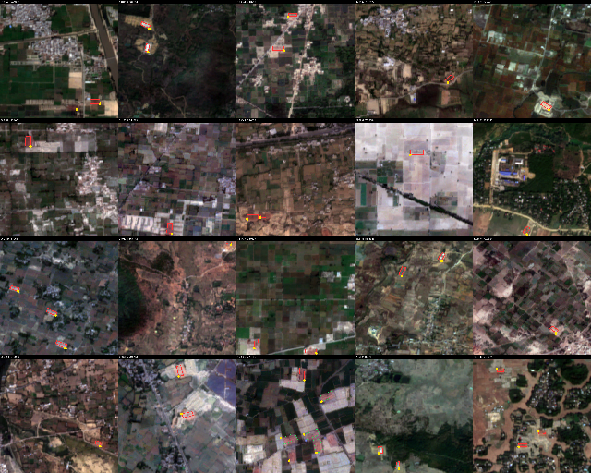
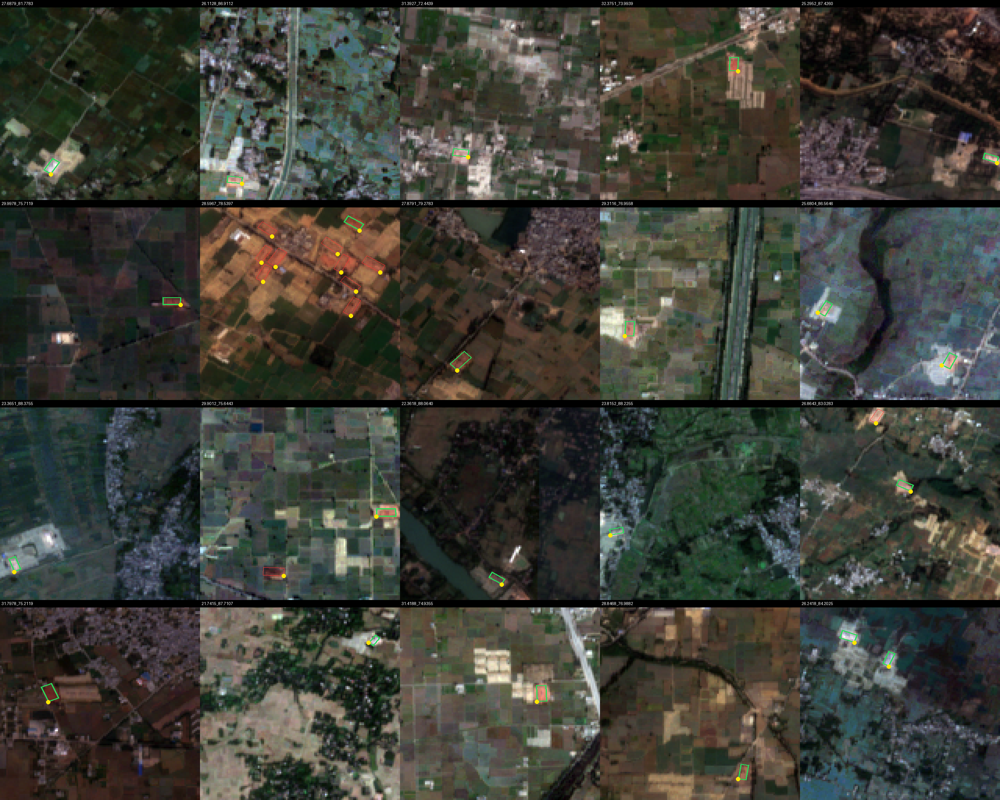
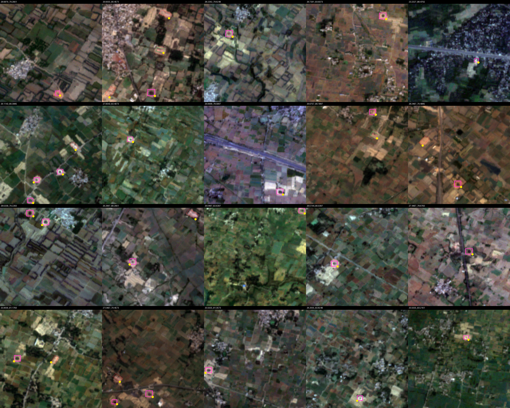

# KilnTrace

**Track 4: Climate Data & Environmental Monitoring** — IEEE ClimateChain Global Hackathon.

AI finds every brick kiln from free satellite images, flags polluting ones during smog bans, and
locks the evidence on-chain so inspection records can't be faked or erased.

## Status

Work in progress.

| Part | Folder | Status |
|---|---|---|
| Frozen record format + Merkle tree | `schemas/`, `pipeline/merkle.py` | done (Phase 1) |
| Sample data for UI work | `fixtures/sample_run/` | done (Phase 1) |
| Dataset conversion + label checks | `ml/prepare_dataset.py`, `ml/draw_labels.py` | done (Phase 2) |
| Model training | `ml/` | planned |
| Satellite pipeline | `pipeline/` | planned |
| Smart contract | `contracts/` | planned (Person B) |
| Backend API | `backend/` | planned (Person B) |
| Dashboard + field app | `web/` | planned (Person B) |
| Independent verifier | `verifier/` | planned |

## Training data checks

SentinelKilnDB converted to YOLO-OBB: 114,300 tiles (128 x 128 px, 10 m/px). Box counts match the
dataset card exactly (train 63,787 / val 21,042 / test 12,819), with 0 malformed labels and 0
class mismatches against the DOTA labels. Random training tiles per class, labels drawn on top
(tiles upscaled 4x; yellow dot = first corner):

| FCBK | Zigzag | CFCBK |
|---|---|---|
|  |  |  |

## Setup (Python)

```bash
conda create -n kilntrace -c conda-forge python=3.11 -y
conda activate kilntrace
pip install torch torchvision --index-url https://download.pytorch.org/whl/cu128
pip install -r requirements-lock.txt
pytest -q
```

## Credits and licence notes

Training data: **SentinelKilnDB** (Sustainability Lab, IIT Gandhinagar; NeurIPS 2025 Datasets and
Benchmarks), released under CC BY-NC 4.0 for non-commercial use.
https://huggingface.co/datasets/SustainabilityLabIITGN/SentinelKilnDB

District boundaries: geoBoundaries (PAK ADM2). Satellite imagery: Copernicus Sentinel-2 via
Microsoft Planetary Computer.
